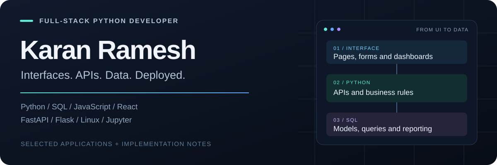

  

# Hi, I'm Karan

I build Python web applications, operational dashboards and data workflows.
My projects connect practical business needs with APIs, relational databases,
responsive interfaces and deployment on Raspberry Pi.

**Python · SQL · Jupyter Notebooks · HTML · CSS · JavaScript**

[Explore my projects](#selected-projects) · [Code by skill](#code-by-skill) · [Degen Predictions](https://degenpredictions.com)

## Selected projects

### 01 / Smart Mini-Dairy Dashboard

**Python · FastAPI · SQLAlchemy · SQLite · Jinja2**

A dairy-operations application for herd profiles, station monitoring, milk-yield
reports and feed inventory. Includes CSV/XLSX imports, business-rule tests and a
responsive dark/light interface.

[Source & setup](https://github.com/karna012/SmartMiniDairyDashboard) · [Data models](https://github.com/karna012/SmartMiniDairyDashboard/blob/main/models.py) · [Business-rule tests](https://github.com/karna012/SmartMiniDairyDashboard/blob/main/tests/test_business_rules.py)

### 02 / Degen Predictions

**Python · Flask · SQLite · HTML / CSS / JavaScript · Raspberry Pi**

A multi-sport analytics website with fixtures, model-based predictions, account
and membership flows, an admin console and Telegram automation. The website is
hosted on Raspberry Pi, with heavier processing kept on a separate PC.

[Visit the website](https://degenpredictions.com) · Application source remains private.

### 03 / Xstreem Car Care

**Python · FastAPI · SQL / SQLite · Ollama · HTML / CSS / JavaScript**

A car-care business application bringing together bookings, customer and vehicle
records, services and payments. A local Ollama integration answers business
questions through the website's chatbot.

[Source & project overview](https://github.com/karna012/Xstreem_car_care) · [SQL implementation](https://github.com/karna012/Xstreem_car_care/blob/main/database.py) · [AI integration](https://github.com/karna012/Xstreem_car_care/blob/main/ai_service.py)

### 04 / Python Data Analysis

**Python · Jupyter Notebooks · pandas · NumPy · Matplotlib · seaborn**

A collection of exploratory data-analysis notebooks covering data inspection,
tabular analysis and visualization. These are learning and analysis artifacts,
separate from my deployed applications.

[Browse the notebooks](https://github.com/karna012/Data-Analysis-using-python)

## Code by skill

| Skill | Where to see it |
| --- | --- |
| **Python** | [FastAPI routes, imports and reporting](https://github.com/karna012/SmartMiniDairyDashboard/blob/main/app.py) |
| **SQL / SQLite** | [Relational tables, joins and queries](https://github.com/karna012/Xstreem_car_care/blob/main/database.py) · [SQLAlchemy models and indexes](https://github.com/karna012/SmartMiniDairyDashboard/blob/main/models.py) |
| **Jupyter Notebooks** | [Python data-analysis collection](https://github.com/karna012/Data-Analysis-using-python) |
| **HTML / CSS / JavaScript** | [Server-rendered UI](https://github.com/karna012/SmartMiniDairyDashboard/tree/main/templates) · [Theme and interaction assets](https://github.com/karna012/SmartMiniDairyDashboard/tree/main/static) |
| **Testing** | [Domain-rule tests](https://github.com/karna012/SmartMiniDairyDashboard/blob/main/tests/test_business_rules.py) · [Browser theme checks](https://github.com/karna012/SmartMiniDairyDashboard/blob/main/tests/check_degen_theme.py) |
| **API / AI integration** | [Async HTTP client and local Ollama integration](https://github.com/karna012/Xstreem_car_care/blob/main/ai_service.py) |

## What I'm building around

- **Backend development:** Python, FastAPI, Flask, relational data and APIs.
- **Data work:** SQL, pandas, NumPy and notebook-based exploration.
- **End-to-end delivery:** templates, mobile layouts, Git, Linux and Raspberry Pi hosting.

Public application repositories include setup instructions and implementation
details. Review each project's security notes before deploying with real data;
live databases and production credentials are not portfolio assets.
